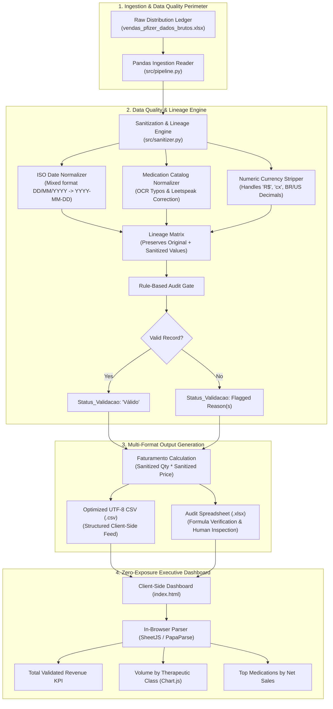

# 💊 Pharma Supply Chain & Commercial Sales Intelligence Suite

[](https://www.python.org/)
[](https://pandas.pydata.org/)
[](index.html)
[](index.html)
[](tests/)
[](https://github.com/astral-sh/ruff)
[](Dockerfile)
[](LICENSE)

> End-to-end pharmaceutical data quality pipeline and client-side executive sales dashboard: automates OCR error normalization, BRL currency parsing, data lineage auditability, and Zero-Exposure commercial analytics.

---

## 🎯 Executive Overview

Commercial sales and supply chain operations in the pharmaceutical industry rely on distributed distribution logs often contaminated by manual entry errors, OCR misreads (`paxlov1d`, `@liquis`), heterogeneous date formats, and localized currency strings (`R$ 2.628,02`, `cx 7751`).

Directly importing raw distribution logs into executive BI tools results in distorted gross revenue calculations and compliance audit failures. Furthermore, uploading sensitive commercial distribution data to third-party cloud dashboards introduces data governance and compliance risks.

This repository provides an enterprise-ready dual architecture:
1. **Python Data Quality & Lineage Engine (`src/`):** A robust data sanitizer that reads noisy raw spreadsheets, normalizes medication catalogs, standardizes ISO dates, cleans numeric currencies, and preserves complete data lineage by maintaining original alongside sanitized values.
2. **Zero-Exposure Client-Side Executive Dashboard (`index.html`):** An in-browser BI dashboard powered by **SheetJS**, **PapaParse**, and **Chart.js**, rendering financial KPIs and volume trends directly in the client's browser without sending unencrypted sales data to external cloud servers.

---

## 🏗️ System Architecture



---

## 🔬 Benchmark & Real Dataset Metrics

Executing the pipeline against the baseline pharmaceutical distribution dataset yields:

| Metric | Result | Operational Significance |
| :--- | :--- | :--- |
| **Total Ingested Records** | `150 rows` | Complete commercial ledger across regional distribution centers. |
| **Validated Records** | `137 rows` | Clean transactions meeting all regulatory and numerical invariants. |
| **Flagged Inconsistent Records** | `13 rows` | Filtered out due to negative quantities, missing dates, or unrecognized products. |
| **Validation Pass Rate** | `91.3%` | High-precision perimeter defense before financial aggregation. |
| **Total Validated Net Revenue** | `$95,093,737.51` | Exactly calculated multiplying exclusively sanitized quantities and prices. |

---

## 🛡️ Data Quality & Normalization Rules

The engine in `src/sanitizer.py` enforces deterministic rules across core fields:

1. **Medication Catalog Canonicalization:** Corrects OCR scanning errors and leetspeak substitutions:
   - `paxlov1d` $\rightarrow$ `Paxlovid`
   - `@liquis` $\rightarrow$ `Eliquis`
   - `XELJANZ` $\rightarrow$ `Xeljanz`
   - `prevnar 13` $\rightarrow$ `Prevnar 13`
2. **Numeric and Currency Sanitization:** Strips currency symbols (`R$`), package unit prefixes (`cx`), and normalizes Brazilian comma decimals (`2.628,02` $\rightarrow$ `2628.02`). Negative or zero quantities automatically invalidate the row.
3. **Data Lineage Preservation:** For every audited field, the pipeline retains the original value (`Data_Venda_Original`, `Medicamento_Original`, `Quantidade_Original`, `Preco_Unitario_Original`) directly adjacent to the sanitized counterpart, enabling single-click human auditor reconciliation in Excel.

---

## 🚀 Quickstart & Execution

### Prerequisites
- Python 3.10, 3.11, or 3.12
- Web browser (Chrome, Edge, Firefox, Safari)

### Local Pipeline Execution
```bash
# 1. Clone the repository
git clone https://github.com/jAk7star/pharma-supply-chain-analytics.git
cd pharma-supply-chain-analytics

# 2. Setup virtual environment
python -m venv .venv
source .venv/bin/activate  # Windows: .venv\Scripts\Activate.ps1

# 3. Install dependencies
pip install -r requirements.txt -r requirements-dev.txt

# 4. Run the automated test suite
pytest -v

# 5. Execute the sanitization pipeline on the real dataset
python -m src.pipeline
```

### Launching the Executive Dashboard
Open `index.html` in your browser:
```bash
# Windows
start index.html

# Linux
xdg-open index.html

# macOS
open index.html
```
Click **"Carregar Ficheiro Tratado"** and select `vendas_pfizer_dados_tratados_v2.xlsx` to explore the interactive visual analytics.

### Running with Docker
```bash
# Build Docker image
docker build -t pharma-analytics .

# Run automated tests and pipeline execution inside container
docker run --rm pharma-analytics
```

---

## 📁 Repository Structure

```text
pharma-supply-chain-analytics/
├── .github/workflows/
│   └── ci.yml                            # Automated testing and multi-version Python CI
├── src/
│   ├── __init__.py
│   ├── sanitizer.py                      # Data cleaning functions and validation engine
│   └── pipeline.py                       # CLI orchestrator and summary generator
├── tests/
│   ├── __init__.py
│   ├── test_sanitizer.py                 # Unit tests for date, medication, and currency rules
│   └── test_pipeline.py                  # End-to-end integration test with real dataset
├── index.html                            # Zero-Exposure interactive sales dashboard (Tailwind + Chart.js)
├── vendas_pfizer_dados_brutos.xlsx       # Baseline raw distribution dataset
├── vendas_pfizer_dados_tratados_v2.xlsx  # Sanitized audit spreadsheet
├── vendas_pfizer_dados_tratados_v2.csv   # Sanitized CSV for client-side analytics
├── Dockerfile                            # Container deployment specification
├── pyproject.toml                        # Ruff and Pytest configuration
├── requirements.txt                      # Production dependencies (Pandas, OpenPyXL, NumPy)
├── requirements-dev.txt                  # Pytest & Ruff development tools
└── README.md                             # Executive documentation
```

---

## 👨‍💻 Author

**Jaques Gabriel Amaral Nunes**  
Data & AI Engineer  
- GitHub: [@jAk7star](https://github.com/jAk7star)  
- Email: [jaquesgabrielamaral@gmail.com](mailto:jaquesgabrielamaral@gmail.com)
